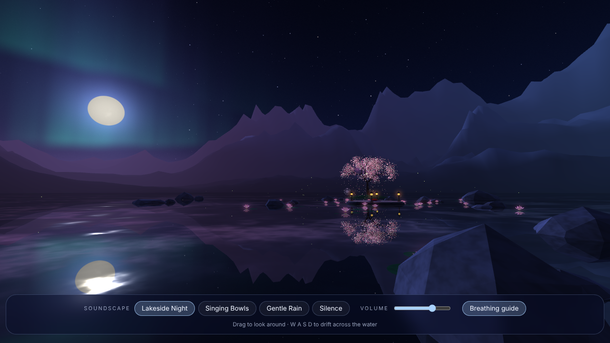

# Stillwater

A personal sanctuary for meditation, on screen and in VR headsets: a moonlit lake to rest
beside, and immersive journeys of light, fractals and sacred geometry.



In the home scene, a stone circle rests on a mirror-still lake. Lanterns flicker at its rim, a blossom
tree sheds petals on a nearby islet, lotus flowers drift on the water, and an aurora
moves slowly over snow-capped mountains. A breathing guide hovers over the water, and
selectable soundscapes fill the space.

## Scenes

Pick a scene from the bar at the bottom of the page, or from the panel in VR (grip).

| | |
|---|---|
| **Stillwater Lake** | The home scene: explore it freely |
| **Prism Gates** | Nested rings of glowing polygons twisting against each other |
| **Fractal Passage** | An endless shaft through a Menger sponge |
| **Spiral Drift** | Coiling arms of stars streaming past |
| **Kaleido Vortex** | A tunnel whose walls are a slowly morphing fractal |
| **Into the Light** | A slow approach toward a radiant source, through shafts and halos of light |
| **Lotus Mandala** | Great flowers of light that open, ring by ring, as you arrive |
| **Hall of Light** | An endless vaulted nave of luminous arches over a mirror floor |
| **Flower of Life** | Turning seals of interlocking circles and star figures |


All but the lake are *journeys*: you are carried gently and endlessly forward while the
forms shift in colour and shape over time. They are real 3D geometry, so they have
depth in a headset. Walking and teleporting are switched off during a journey, and a
still ring stays at your feet as a fixed reference for comfort. If forward motion in
VR makes you queasy, sit down or return to the lake.

**Sitting or lying down.** A journey points wherever you are looking when it starts:
level if you are sitting or standing, straight up if you are lying on your back, and
along your gaze if you are reclined. If you change position, look where you want to
travel and choose **Re-aim path** (in the bar, in the VR panel, or by clicking a
thumbstick).

To add a journey, write a module in `src/journeys/` that lays its elements along the
z axis and wraps them with the shared `uTravel` uniform (see `prism.js` for the
shortest example), then add one line to the manifest in `src/scenes.js`.

## Run it

It is a static site with no build step.

```bash
python3 -m http.server 8000
```

Then open `http://localhost:8000`.

To use a headset, the page must be served over **https** (WebXR requires a secure
origin). The simplest route is GitHub Pages: *Settings → Pages → Deploy from a
branch → `main` / root*. Then open the Pages URL in the headset's browser (Meta
Quest Browser, Pico, Vision Pro Safari, etc.) and press **Enter VR**.

## Controls

| | |
|---|---|
| **Screen** | Drag to look · `W A S D` / arrows to drift across the water · `Shift` to go faster |
| **VR: trigger or pinch** | Hold to aim the arc, release to teleport (you can walk on the water) |
| **VR: left thumbstick** | Glide slowly in the direction you are looking |
| **VR: right thumbstick** | Snap turn |
| **VR: thumbstick click** | In a journey: re-aim the path where you are looking |
| **VR: grip** | Open / close the settings panel (scene, soundscape, volume, breathing guide) |
| **VR: hands** | Pinch the small glowing orb floating at your lower left to open the panel |

## Adding soundscapes

All audio goes through `src/audio/`:

- `soundscapes.js` — the manifest. Every entry shows up automatically in the page
  bar and in the in-VR panel.
- `AudioEngine.js` — loading, looping, crossfading, master volume, and optional
  HRTF positioning (the listener rides on the visitor's head).
- `synth.js` — procedural layers (wind, water, rain, singing bowls) so the scene
  has sound without any audio files.

To add your own, drop files in `assets/audio/` and add an entry:

```js
{
  id: 'forest-dawn',
  name: 'Forest Dawn',
  description: 'Birdsong and a distant stream',
  layers: [
    { type: 'file', url: 'assets/audio/forest-dawn.ogg', gain: 0.9 },
    // give a layer a position and it is anchored in the world (here: the island)
    { type: 'file', url: 'assets/audio/stream.ogg', gain: 0.5, position: [9, 0.5, -13] },
    // file and procedural layers can be mixed
    { type: 'synth', generator: 'wind', gain: 0.15 },
  ],
},
```

Use recordings that loop seamlessly; switching soundscapes crossfades over a few seconds.

## How it is built

- [three.js](https://threejs.org) (vendored in `vendor/`), plain ES modules, WebXR.
- The lake is a true mirror: the world is drawn a second time flipped through the
  waterline and a translucent rippling surface is laid over it. This is cheap and
  stereo-correct, which keeps standalone headsets at full frame rate.
- Everything is procedural (geometry, sky, noise, sound) so there are no assets to download.

```
index.html            page shell
css/style.css         welcome veil and settings bar
src/main.js           renderer, scene assembly, frame loop
src/state.js          settings store (scene, soundscape, volume, breathing guide)
src/scenes.js         scene manifest and switching
src/world/            sky, water, mountains, platform, island + tree, flora, breathing guide
src/journeys/         forward-flight scenes (one module each) and their shared parts
src/xr/               teleport / glide / snap turn, in-VR settings panel
src/ui/               screen controls and HUD
src/audio/            soundscape manifest, audio engine, procedural generators
```
