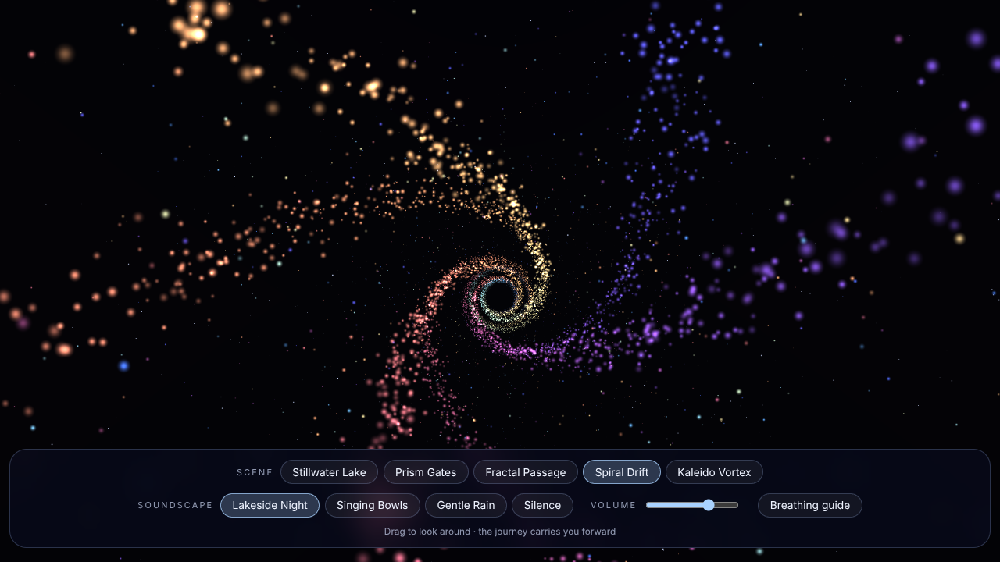

# Stillwater

A personal sanctuary for meditation, on screen and in VR headsets: a moonlit lake to rest
beside, and immersive journeys of light, fractals and sacred geometry.


In the home scene, a stone circle rests on a mirror-still lake. Lanterns flicker at its rim, a blossom
tree sheds petals on a nearby islet, lotus flowers drift on the water, and an aurora
moves slowly over snow-capped mountains. A breathing guide hovers over the water, and
selectable soundscapes fill the space.

## Scenes

Pick a scene from the bar at the bottom of the page (the arrows step through them; the
name opens the full list), or from the panel in VR (grip).

**Sanctuary**

Still places to stand in and wander around.

| | |
|---|---|
| **Stillwater Lake** | The home scene: moonlit water, lanterns and a blossom tree |
| **Dock at Dusk** | A wooden dock reaching into a still lake under a pink sky |
| **Sunset Beach** | Warm sand, leaning palms and a low sun over a calm sea |
| **Mountain Chalet** | A snowbound chalet with lit windows, snow falling |
| **Quiet Cabin** | A log cabin in a pine clearing at blue hour, a fire going |
| **Japanese Garden** | A pond, an arched bridge, stone lanterns, maples and a tea pavilion |
| **Autumn Forest** | A path through tall trees in full colour, leaves drifting down |
| **Golden Farm** | Striped fields over rolling hills, a red barn and a turning windmill |
| **Amalfi Terrace** | A pergola terrace on a cliff above pastel houses and blue sea |
| **Lavender Hills** | Purple rows rolling to the horizon at sunrise, balloons adrift |
| **Waterfall Grotto** | A jungle pool beneath a tall fall, mist rising |
| **Orbital Lounge** | An observation deck in orbit above a slowly turning blue world |

**Cityscapes**

Streets to stroll down.

| | |
|---|---|
| **Festival Street** | A sunlit arcade street under hundreds of swaying paper kites |
| **Glass Arcade** | A grand shopping gallery under an iron-and-glass vault and dome |
| **Antigua Arch** | A cobbled colonial street, a yellow clock arch, a volcano beyond |
| **Canal at Dusk** | Lamplit quays and tall houses along still water, boats rocking |

**Screensaver classics**

| | |
|---|---|
| **Starfield** | The classic screensaver in real depth: plain white stars drifting past |
| **Glyph Rain** | Falling code in depth: a forest of columns of flickering green characters |
| **Pipe Dream** | Pipes growing through space, turning at right angles, until it fills and starts over |
| **Mystify** | A flight through gliding polygons whose corners bounce off unseen walls, trailing fans of echoes |
| **Soap Bubbles** | A drift forward through iridescent bubbles wobbling upward |
| **Aquarium** | Swimming forward through blue water past school after school of bright fish |
| **Fireworks** | A flight through a display, shells bursting ahead, beside, above and below |
| **Ember Streams** | A flight among swirling ribbons of sparks with long fading trails |

**Cosmic Drift**

Flights through the cosmic web: glowing knots joined by filaments, on every side of you,
undulating, swelling and changing colour as you go.

| | |
|---|---|
| **Golden Web** | Amber knots burning white at their hearts, on black |
| **Violet Tide** | Provinces of teal fire in a violet sea, the border always moving |
| **Midnight Filaments** | A fine navy lace with yellow sparks where threads meet |
| **Ember Nebula** | Cold blue lace crossing banks of orange fire |
| **Aurora Web** | Every colour in turn, sweeping through the web in slow bands |
| **Pulsar Bloom** | Knots swelling to blossoms and shrinking to sparks |
| **Dark Matter Storm** | The whole web turning and writhing, indigo shot with lime |
| **Genesis** | Structure condensing out of a glowing fog and dissolving back into it |

**Stars and geometry**

| | |
|---|---|
| **Prism Gates** | Nested rings of glowing polygons twisting against each other |
| **Spiral Drift** | Coiling arms of stars streaming past |
| **Kaleido Vortex** | A tunnel whose walls are a slowly morphing fractal |

**Fractal architecture**

| | |
|---|---|
| **Fractal Passage** | An endless shaft through a Menger sponge |
| **Cantor Dust** | Cubes scattered into clusters of clusters, with open lanes between |
| **Jack Lattice** | Three-armed crosses built of smaller crosses, linking overhead |
| **Snowflake Vault** | A slowly twisting tunnel whose cross-section is a Koch snowflake |
| **Hilbert Pipeworks** | One unbroken pipe that fills all of space, with light running along it |
| **Branching Arcade** | Trees that fork again and again, knitting a vault around the path |
| **Breathing Sponge** | The Menger shaft alive: blocks swell and shrink so its holes keep opening and closing |
| **Unfolding Dust** | Solid blocks split into eight, then sixty-four, drift apart into dust and gather again |
| **Blooming Jacks** | Crosses made of crosses whose arms reach out and draw back |
| **Pyramid Hall** | Pyramids built of pyramids reach in from every side, their tiers rising and settling |
| **Carpet Gates** | You pass through the middle of one Sierpinski carpet after another, holes widening and closing |
| **Corner Reef** | Cubes that bud smaller cubes from every corner, pushing out and sinking back |

**Light**

| | |
|---|---|
| **Into the Light** | A slow approach toward a radiant source, through shafts and halos of light |
| **Lotus Mandala** | Great flowers of light that open, ring by ring, as you arrive |
| **Hall of Light** | An endless vaulted nave of luminous arches over a mirror floor |
| **Flower of Life** | Turning seals of interlocking circles and star figures |

**Hypnotic**

| | |
|---|---|
| **Liquid Rainbow** | Colours folding over each other like oil on water |
| **Hypno Spiral** | Broad spiral arms winding down the tunnel |
| **Op-Art Warp** | A black and white chequerboard that swells and pinches |
| **Moiré Waves** | Two sets of fine lines sliding across each other, raising broad fringes |
| **Honeycomb Hive** | Hexagonal cells lighting up in slow travelling waves |
| **Stained Glass** | Drifting cells of colour held in dark leading |
| **Labyrinth Flow** | Endless interlocking arcs with light running along them |
| **Slit-Scan Gate** | Four walls of streaming colour meeting at a vanishing point |
| **Wormhole** | A tube of light that snakes away ahead of you |
| **Neon Horizon** | A glowing grid rolling over a valley toward a striped sun |
| **Lava Lamp** | The tunnel wall swells into great soft blobs that merge and sink away |
| **Polymorph** | A dense shoal of solids melting between diamond, ball and cube |

**Striped worlds**

Tunnels packed wall to wall with solid forms in bold repeating bands of two vivid
colours and black. You are fully enclosed, and the colourway drifts through eight
pairings as you travel.

| | |
|---|---|
| **Candy Horns** | Curling striped horns crowding in from every side on one great spiral |
| **Romanesco** | Cones covered in spirals of smaller cones, like the vegetable |
| **Bullseye Bloom** | Swelling domes ringed like targets, large and small |
| **Dragon Scales** | Overlapping scales laid like roof tiles, ruffling as you pass |
| **Serpent Coil** | Fat striped bodies woven around the tunnel in both directions |
| **Tidal Bloom** | Domes that rise into peaks as waves run down the tunnel, rings pouring outward |
| **Whirlpool Eyes** | Every dome a spinning spiral, neighbours turning opposite ways |
| **Shapeshifter** | Forms melting between soft domes and sharp spires |
| **Budding Bloom** | Great domes crowned with slowly circling smaller domes |
| **Living Bloom** | Bullseyes that drift across the wall, press together, merge and part |
| **Toadstool Grove** | Striped stalks under ringed caps that open and close |
| **Anemone Garden** | Thousands of slender tentacles with waves running root to tip |

**Forms in motion**

| | |
|---|---|
| **Gyro Rings** | Paired hoops rocking against each other like a gyroscope |
| **Silk Ribbons** | Long bands of colour weaving and twisting around you |
| **Cube Swarm** | Hundreds of tumbling, breathing cubes |
| **Sierpinski Drift** | Fractal pyramids made of pyramids made of pyramids |
| **Crystal Cavern** | A throat of iridescent crystal shards |
| **Monolith Grove** | Ranks of tall slabs rising and falling in waves |
| **Double Helix** | Twin strands of light and their rungs coiling around you |
| **Spirograph** | Looping curves that slowly redraw themselves |
| **Bloom Bursts** | Seeds of light that open into dandelion heads as you reach them |
| **Jellyfish Deep** | Luminous jellyfish pulsing through dark water |



The Sanctuary and Cityscape scenes are *places*: you can walk, glide and teleport around
them as you can at the lake. The rest are *journeys*: you are carried gently and endlessly forward while the
forms shift in colour and shape over time. They are real 3D geometry, so they have
depth in a headset. Walking and teleporting are switched off during a journey, and a
still ring stays at your feet as a fixed reference for comfort. If forward motion in
VR makes you queasy, sit down or return to the lake.

**A caution.** The hypnotic scenes use strong, constantly moving patterns. Nothing
flashes or strobes, but if you are sensitive to such patterns, or begin to feel dizzy
or unwell, look away and return to Stillwater Lake.

**Favorites.** Select the star beside any scene or soundscape to mark it as a favorite.
Favorite scenes get their own group at the top of the scene list (in VR, use *Show
favorites only*), favorite soundscapes move to the front, and the star in the bar marks
the scene you are in. Favorites are remembered on the device.

**Solid things are solid.** In the places you cannot walk, glide or teleport through
buildings, trees, rocks, posts or railings, or up cliffs and steep mountainsides; you
slide along them instead. Low things underfoot and things overhead do not block you.

**Sitting or lying down.** A journey points wherever you are looking when it starts:
level if you are sitting or standing, straight up if you are lying on your back, and
along your gaze if you are reclined. If you change position, look where you want to
travel and choose **Re-aim path** (in the bar, in the VR panel, or by clicking a
thumbstick).

To add a place, write a builder with the kit in `src/places/kit.js` (sky, terrain, water,
simple solids, trees, drifting motes, lamps); `nature.js` and `cities.js` hold the existing ones.

To add a journey, add one line to the manifest in `src/scenes.js` pointing at a
function that returns a group and a speed. Most scenes are a few lines of shader in
one of four small families, each of which handles the endless wrapping for you:

- `morphing.js` — fractals whose levels can slide apart, close up and swell (Unfolding Dust, Carpet Gates, ...)
- `cosmic.js` — cosmic webs: knots and filaments in points of light, inside painted web layers (Golden Web, Genesis, ...)
- `fractals.js` — structures assembled from boxes, with glowing edges (Cantor Dust, Hilbert Pipeworks, ...)
- `striped.js` — tunnels packed with banded solid forms (Candy Horns, Romanesco, ...)
- `walls.js` — a tube painted by a fragment shader (Hypno Spiral, Stained Glass, ...)
- `solids.js` — many copies of one 3D shape, placed by a vertex shader (Gyro Rings, Crystal Cavern, ...)
- `particles.js` — forms drawn in points of light (Double Helix, Jellyfish Deep, ...)
- `planes.js` — open scenes built from flat sheets (Neon Horizon, Slit-Scan Gate, Wormhole)

## Run it

It is a static site with no build step.

```bash
python3 -m http.server 8000
```

Then open `http://localhost:8000`.

To use a headset, the page must be served over **https** (WebXR requires a secure
origin). The simplest route is GitHub Pages: *Settings → Pages → Deploy from a
branch → `main` / root*. Then open the Pages URL in the headset's browser (Meta
Quest Browser, Pico, Vision Pro Safari, etc.) and press **Enter VR**.

## Controls

| | |
|---|---|
| **Screen** | Drag to look · `W A S D` / arrows to drift across the water · `Shift` to go faster |
| **VR: trigger or pinch** | Hold to aim the arc, release to teleport (you can walk on the water) |
| **VR: left thumbstick** | Glide slowly in the direction you are looking |
| **VR: right thumbstick** | Snap turn |
| **VR: thumbstick click** | In a journey: re-aim the path where you are looking |
| **VR: grip** | Open / close the settings panel (scene, soundscape, volume, breathing guide) |
| **VR: hands** | Pinch the small glowing orb floating at your lower left to open the panel |

## Adding soundscapes

All audio goes through `src/audio/`:

- `soundscapes.js` — the manifest. Every entry shows up automatically in the page
  bar and in the in-VR panel.
- `AudioEngine.js` — loading, looping, crossfading, master volume, and optional
  HRTF positioning (the listener rides on the visitor's head).
- `synth.js` — procedural layers (wind, water, rain, singing bowls) so the scene
  has sound without any audio files.

To add your own, drop files in `assets/audio/` and add an entry:

```js
{
  id: 'forest-dawn',
  name: 'Forest Dawn',
  description: 'Birdsong and a distant stream',
  layers: [
    { type: 'file', url: 'assets/audio/forest-dawn.ogg', gain: 0.9 },
    // give a layer a position and it is anchored in the world (here: the island)
    { type: 'file', url: 'assets/audio/stream.ogg', gain: 0.5, position: [9, 0.5, -13] },
    // file and procedural layers can be mixed
    { type: 'synth', generator: 'wind', gain: 0.15 },
  ],
},
```

Use recordings that loop seamlessly; switching soundscapes crossfades over a few seconds.

## How it is built

- [three.js](https://threejs.org) (vendored in `vendor/`), plain ES modules, WebXR.
- The lake is a true mirror: the world is drawn a second time flipped through the
  waterline and a translucent rippling surface is laid over it. This is cheap and
  stereo-correct, which keeps standalone headsets at full frame rate.
- Everything is procedural (geometry, sky, noise, sound) so there are no assets to download.

```
index.html            page shell
css/style.css         welcome veil and settings bar
src/main.js           renderer, scene assembly, frame loop
src/state.js          settings store (scene, soundscape, volume, breathing guide)
src/scenes.js         scene manifest and switching
src/world/            sky, water, mountains, platform, island + tree, flora, breathing guide
src/journeys/         forward-flight scenes (one module each) and their shared parts
src/places/           explorable places: the building kit, sanctuaries and cityscapes
src/xr/               teleport / glide / snap turn, in-VR settings panel
src/ui/               screen controls and HUD
src/audio/            soundscape manifest, audio engine, procedural generators
```
